# OpenPI 模块关系图

> 本文回答一件事：**25 个扩展之间是什么关系**。
> 依赖方向全部按实测 `import` 绘制，不按文档叙述推断（核实方法见文末）。
> 职责与规模见 [`onboarding.md`](onboarding.md) 第 2 节；运行时语义见 README「运行模型」。
> 本仓库为**分析**而存，不做工程演进：本文仅用于理解代码，不作为上游贡献候选，也不修改上游已跟踪文件。

## 全图

```mermaid
flowchart TB
    U["👤 用户<br/>(TUI 交互 / 自然语言意图)"]

    subgraph HOST["Pi Host（原生，非本仓库）"]
        H1["Session · Provider · Model · Trust"]
        H2["工具注册 · before_agent_start 钩子"]
        H3["TUI 渲染 · 编辑器层"]
        SDK["createAgentSession()<br/>进程内子会话工厂"]
    end

    subgraph ENTRY["入口与配置"]
        cap["capabilities<br/>能力发现 openpi_load_tools"]
        setup["setup<br/>/openpi-setup 单入口"]
    end

    subgraph EXEC["执行路径（三条，互不调用）"]
        bg["background-terminals<br/>后台长进程 · /ps"]
        sub_["subagents<br/>子 Agent · /subagents"]
        wf["workflows<br/>多阶段编排 · /workflows<br/>sandbox · ledger · replay · artifacts"]
    end

    roles["subagents/src/agent-types.ts<br/>角色定义 · 模型解析<br/>(唯一跨执行扩展的复用点)"]

    subgraph CONT["连续性（只记录与控制，不执行）"]
        tasks["tasks 工作项"]
        goal["goal 持续目标"]
        plan["plan-mode 计划门禁"]
        pivot["context-pivot 阶段切换"]
        cron["cron 定时 prompt"]
        sess["sessions 会话浏览"]
    end

    subgraph TOOLS["工具与安全"]
        search["file-search (fd / rg)"]
        git["git-read (git_show/diff/log)"]
        ask["ask-user / human_handoff"]
        guard["workspace-cleanup-guard<br/>rm 护栏"]
    end

    subgraph UI["终端体验"]
        ui["ui-customization Footer/Header"]
        sugg["suggestions 下一步建议"]
        mut["file-mutation-display"]
        misc["turn-time · model-info<br/>git-info · user-input-fold · copy-all"]
    end

    subgraph SHARED["shared/ 公共层（改动前先查消费方）"]
        cs["child-session<br/>子会话工具边界 (fail-closed)"]
        wt["worktree 隔离 checkout"]
        sc["setup-config 配置读写"]
        tt["terminal-text 输出清洗"]
        tsf["tool-surface 工具面管理"]
    end

    U -->|"能力意图"| cap
    U -->|"/openpi-setup"| setup
    cap -->|"before_agent_start 注册"| H2
    cap -.->|"按需激活"| bg
    cap -.->|"按需激活"| sub_
    cap -.->|"按需激活"| wf
    cap -.->|"按需激活"| search
    cap -.->|"按需激活"| git
    cap --> tsf

    sub_ -->|"每个子 Agent 一个"| SDK
    wf -->|"每次 agent() 一个"| SDK
    wf -->|"复用角色/模型解析"| roles
    sub_ --> roles
    sub_ --> cs
    wf --> cs
    sub_ --> wt
    wf --> wt
    bg --> tt
    bg --> tsf

    setup -->|"typed 受限写入"| sc
    bg -.->|"读"| sc
    ui -.->|"读"| sc
    sugg -.->|"读"| sc

    plan -->|"只读调研"| search
    plan -->|"只读 Git"| git
    sess -->|"安全切换"| H1
    pivot -->|"定向压缩"| H1
    cron -->|"排入 prompt"| H1

    bg -->|"运行状态"| ui
    sub_ -->|"运行状态"| ui
    wf -->|"运行状态"| ui
    ui --> H3
    mut --> H3
    ask -->|"等待人工决策"| U
    sugg -->|"inline 幽灵文字"| U
    guard -->|"拦截危险 rm"| H2

    style ENTRY fill:#fef3c7
    style EXEC fill:#dbeafe
    style CONT fill:#dcfce7
    style TOOLS fill:#ffedd5
    style UI fill:#f3e8ff
    style SHARED fill:#f1f5f9
```



## 读图要点

**1. 一切挂在 Pi Host 上，不另起运行时。** 所有扩展通过 Pi 的工具注册、`before_agent_start` 钩子和 TUI 渲染缝接入。`HOST` 组不属于本仓库。

**2. `capabilities` 是闸门。** 普通回合模型只见 Pi 原生 `read`/`bash`/`edit`/`write`；用户表达能力意图后，它在 `before_agent_start` 把对应工具组加载进工具面（`shared/tool-surface.ts`）。虚线箭头是"激活"，不是函数调用。

**3. 三条执行路径互不调用。** 常见误读是"workflows 调用 subagents"——实测不是：两者各自直接用 Pi SDK 的 `createAgentSession()` 起进程内子会话。唯一的跨扩展复用是 `subagents/src/agent-types.ts`（`loadAgentTypes` / `resolveAgentModel` / `selectSubagentModel` / `roleModelForAgentType`），即角色定义与模型解析。改这个文件要同时验证两条路径。

**4. 子会话的安全边界在 `shared/child-session.ts`。** `subagents` 和 `workflows` 都从这里取工具白名单：`CHILD_SAFE_PACKAGE_TOOL_NAMES` 只放行 5 个只读工具（`fd`/`rg`/`git_show`/`git_diff`/`git_log`），其余本包工具进 `CHILD_EXCLUDED_TOOL_NAMES`。新增工具未分类 = drift guard 测试红（fail-closed）。

**5. 绿色连续性层不执行工作。** tasks/goal/plan-mode/context-pivot/cron/sessions 只记录、批准、压缩和切换。`plan-mode` 的特殊之处是它会为只读调研拉取橙色的 `file-search` / `git-read`。

**6. `shared/setup-config.ts` 是配置单点。** `/openpi-setup` 经受限 typed 工具写入 `~/.pi/agent/my-pi-setup.json`，13 个文件读取它：`background-terminals`、`capabilities`、`file-mutation-display`、`post-edit`、`setup`、`subagents`、`suggestions`（含 `src/config.ts`）、`ui-customization`（含 `footer.ts`）、`workflows`（`index.ts` / `controller.ts` / `sandbox.ts`）。图中只画了 3 条代表性读边。该包自身约定新增配置项要同步五处（见 `onboarding.md` 第 4 节 OP-11），这是读代码时判断配置流向的依据。

**7. `shared/worktree.ts` 的消费方是 5 处。** `subagents/index.ts`、`subagents/src/backends/pi.ts`、`workflows/index.ts`、`workflows/model.ts`、`workflows/worktree-handoff.ts`。清理策略是"状态未知即保留"。

## 如何核实这张图

依赖边可复算，不要凭记忆改：

```bash
# 某个 shared 模块被谁消费
grep -rln 'shared/setup-config' extensions | sort
grep -rln 'shared/child-session' extensions | sort
grep -rln 'shared/worktree' extensions | sort

# 执行扩展之间是否真的互相 import
grep -rn 'from "../subagents' extensions/workflows/*.ts
grep -rn 'from "../workflows' extensions/subagents/**/*.ts

# 子会话工厂来源
grep -rn 'createAgentSession' extensions/workflows/runner.ts extensions/subagents/src/backends/pi.ts
```

拉取上游新代码后重跑上述命令核对；输出与图不一致时以命令输出为准，图是快照而非契约。
